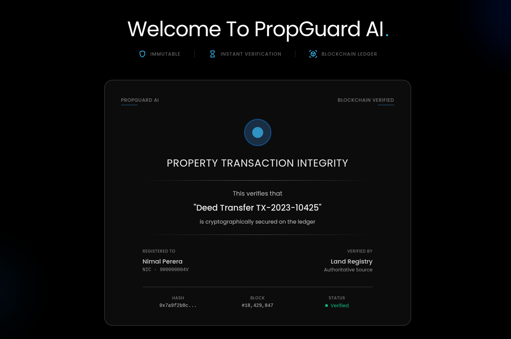
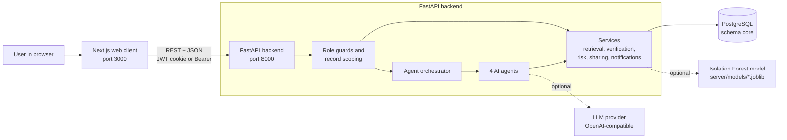
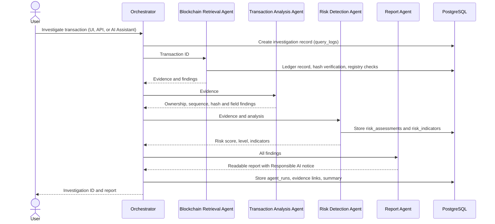

# PropGuard AI

**Multi-Agent AI-Based Blockchain Property Transaction Verification and Fraud Detection System**

> Protecting property transactions with AI and blockchain: tamper-evident land records, explainable fraud-risk checks, and plain-language investigation reports.



| | |
| --- | --- |
| **Product** | PropGuard AI |
| **Academic module** | Information Retrieval and Web Analytics |
| **Domain** | Blockchain |
| **Sub-domain** | Property transaction verification and fraud-risk detection for land registration |
| **Project type** | Academic prototype (decision-support system, not a legal registry) |

## Table of Contents

- [Project Overview](#project-overview)
- [Key Features](#key-features)
- [Assignment Requirements Coverage](#assignment-requirements-coverage)
- [Technology Stack](#technology-stack)
- [System Architecture](#system-architecture)
- [Repository Structure](#repository-structure)
- [Prerequisites](#prerequisites)
- [Installation and Setup](#installation-and-setup)
- [Running the Application](#running-the-application)
- [Usage Guide](#usage-guide)
- [API Documentation](#api-documentation)
- [Testing and Quality Checks](#testing-and-quality-checks)
- [Configuration and Environment Variables](#configuration-and-environment-variables)
- [Documentation and Additional Resources](#documentation-and-additional-resources)
- [Contributing](#contributing)
- [Security](#security)
- [License](#license)
- [Acknowledgements](#acknowledgements)
- [Known Limitations and Future Improvements](#known-limitations-and-future-improvements)

---

## Project Overview

### The problem

Buying land or property is usually a person's largest financial decision, yet checking that a deal is genuine still depends on records that can be altered or misrepresented. Buyers, real-estate companies, and land registries need to answer questions such as:

- Is this property registered, and who is the current recorded owner?
- Does the seller actually own the property?
- Has the title deed or another document been changed after registration?
- Is the transaction recorded on the ledger, and is its hash chain intact?
- Is the price unusual, or has the property changed hands suspiciously often?
- Why was a transaction flagged, and what evidence supports that?

### The solution

PropGuard AI combines four ideas in one web application:

1. **A relational property database** (PostgreSQL) holding properties, transactions, owners, parties, and documents.
2. **A simulated blockchain ledger** that stores SHA-256 fingerprints of each record in a hash-linked chain, signed with an Ed25519 "land registry" key. Any later edit to a record breaks its fingerprint, so tampering becomes detectable.
3. **Information retrieval** over the records: identifier lookup, PostgreSQL full-text search, and a natural-language assistant.
4. **A four-agent AI pipeline** that retrieves evidence, analyses the transaction, scores fraud risk with transparent rules (plus an optional anomaly model), and writes a readable investigation report with a Responsible AI notice.

The output is a **risk indicator for investigation, not a legal judgment of fraud**. The rule-based score stays authoritative; large language models (LLMs) only help with wording and explanation.

### Target users

| User (access level) | What they use PropGuard AI for |
| --- | --- |
| **Super Admin** (`SYSTEM`) | Manage user access, rebuild ledger hashes, view everything |
| **Land Registry** (`REGISTRY`) | Review all records, run investigations, review and verify risk-assessment requests |
| **Real Estate Company** (`COMPANY`) | Verify deals before closing, run investigations, request risk assessments |
| **Public user / property owner or buyer** (`PUBLIC`) | Read-only view of their own and shared properties, ask the AI Assistant, request risk assessments |

---

## Key Features

All features below are implemented in this repository.

**Blockchain integrity (simulated ledger)**
- Canonical SHA-256 hashes: `property_hash`, `transaction_data_hash`, `document_hash`, and a chained `tx_hash` linked by `previous_hash`.
- Ed25519 digital signature over each block's `tx_hash` using a registry key.
- Per-transaction verification that recomputes every hash, plus 15 registry checks (for example "seller is the registered owner").
- Manual-entry comparison on the Blockchain Verification page, and a Super Admin hash rebuild.
- A tamper-detection demo script ([`server/scripts/tamper_demo.sql`](server/scripts/tamper_demo.sql)).

**Information retrieval and analytics**
- Evidence Retrieval: identifier lookup (property, transaction, title deed) and PostgreSQL full-text search with `ts_rank_cd` relevance scoring across properties, transactions, and documents.
- Every query and its retrieved evidence is logged (`query_logs`, `query_retrievals`) with relevance scores and latency.
- Database-backed analytics dashboard (transactions over time, risk distribution, verification failures, query latency).

**Multi-agent AI investigation**
- Four cooperating agents run in sequence by an orchestrator: Blockchain Retrieval → Transaction Analysis → Risk Detection → Report.
- Every agent run is stored in `agent_runs` and linked to one investigation ID, so the interaction between agents is auditable.
- Transparent rule-based risk score with stored indicators and evidence, plus an optional Isolation Forest anomaly model.
- Configurable LLM per agent (OpenAI-compatible providers); if AI is disabled or a call fails, the pipeline falls back to its rule/template result.

**AI Property Assistant (natural language)**
- Users ask questions in plain language (including non-English questions).
- A shared query guard restricts `PUBLIC` users to their own and shared records and refuses identifiers they cannot access.
- Questions about transaction risk automatically run the four-agent investigation; answers link to the detailed Evidence Retrieval view or the investigation report.

**Risk assessment workflow**
- Owners, buyers, and companies request a risk assessment for an accessible property.
- The Land Registry reviews, drafts, verifies, or rejects requests, and a certificate is produced for verified results.

**Property sharing and notifications**
- Owners share a property read-only with a prospective buyer, with optional expiry and revocation.
- The Shared Properties page also lists properties linked through previous ownership or transaction participation.
- In-app notifications for shares, revocations, risk-request results, and access changes.

**Security and access control**
- Email/password login with Argon2 password hashing and JWT sessions in an HttpOnly cookie.
- Server-side role guards on every endpoint and record-level scoping for public users.
- Role-based navigation and route protection in the web client.

---

## Assignment Requirements Coverage

| Requirement | How PropGuard AI implements it |
| --- | --- |
| At least two interacting intelligent agents | Four agents in [`server/app/agents/`](server/app/agents/), chained by [`orchestrator.py`](server/app/agents/orchestrator.py); each run is logged in `core.agent_runs` under one investigation ID |
| Use of LLMs | OpenAI-compatible client ([`server/app/core/llm.py`](server/app/core/llm.py)) with a separate model setting per agent (`AI_RISK_MODEL`, `AI_REPORT_MODEL`, and so on) |
| NLP techniques | Natural-language query parsing, intent detection, and full-text search ([`retrieval_service.py`](server/app/services/retrieval_service.py)); the AI Assistant ([`user_assistant_service.py`](server/app/services/user_assistant_service.py)) |
| Information retrieval module | `GET /api/v1/retrieval/search` with ranked evidence, relevance scores, and query logging |
| Security / input sanitisation | Pydantic validation on every request body, ORM or bound SQL parameters, role guards, record scoping, and a query guard for the assistant |
| Communication protection | JWT (HS256) authentication, HttpOnly SameSite cookies, CORS allow-list, and Ed25519-signed ledger blocks; see [security.md](security.md) for details and known gaps |

---

## Technology Stack

| Layer | Technology | Purpose |
| --- | --- | --- |
| Frontend | [Next.js 16](https://nextjs.org/) (App Router), React 19, TypeScript | Role-based web application |
| UI | Tailwind CSS 4, MUI icons, Recharts, Sonner | Styling, icons, charts, toast messages |
| Client state and data | Zustand, Axios, React Hook Form, Zod | Auth/session state, API calls, form validation |
| Backend | [FastAPI](https://fastapi.tiangolo.com/), Uvicorn, Pydantic, pydantic-settings | REST API, validation, configuration |
| Database | PostgreSQL (schema `core`), SQLAlchemy 2, psycopg2 | Main data store, ORM, driver |
| Security | PyJWT, passlib + argon2-cffi, `cryptography` (Ed25519) | Tokens, password hashing, ledger signatures |
| AI / ML | OpenAI-compatible HTTP API via `httpx`; scikit-learn Isolation Forest, NumPy, joblib | LLM wording and explanations; anomaly detection |
| Quality tools | pytest, Ruff, Pyright, ESLint, Prettier, TypeScript compiler | Tests, linting, formatting, type checking |

The blockchain is a **simulation inside PostgreSQL** (hash-linked, signed rows in `core.blockchain_transactions`). No public blockchain network or smart-contract platform is used.

---

## System Architecture

### Component overview



The web client never talks to the database directly. Every request passes through the FastAPI role guards, and `PUBLIC` users are additionally limited to the properties they own, previously owned, took part in a transaction for, or were explicitly shared.

### Investigation workflow (four agents)



Retrieval and Transaction Analysis are deterministic, so model output can never change the evidence or integrity checks. Risk Detection and Report can use an LLM for wording when `AI_ENABLED=true`.

### Ledger hash model

```text
property_hash          = SHA256(canonical property fields)
transaction_data_hash  = SHA256(canonical transaction fields + property_hash)
tx_hash                = SHA256(previous_hash + transaction_data_hash + block_timestamp)
previous_hash          = "0" for the first block of a property, otherwise the previous tx_hash
digital_signature      = Ed25519 signature of tx_hash with the registry key
document_hash          = SHA256(document_text)
```

The implementation is in [`server/app/core/hashing.py`](server/app/core/hashing.py) and [`server/app/core/signing.py`](server/app/core/signing.py).

---

## Repository Structure

```text
.
├── client/                         # Next.js web application
│   ├── public/                     # Static assets (logo, images)
│   ├── src/
│   │   ├── app/
│   │   │   ├── page.tsx            # Public landing page
│   │   │   ├── (auth)/             # Login and forgot-password pages
│   │   │   ├── (app)/              # Signed-in pages: dashboards, property search,
│   │   │   │                       #   risk analysis, investigation reports, shared
│   │   │   │                       #   properties, blockchain verification, users, settings
│   │   │   └── api/auth/           # Next.js route handlers that set/clear the auth cookie
│   │   ├── components/             # UI components grouped by feature area
│   │   ├── hooks/                  # useAuth, useNotifications
│   │   ├── lib/                    # API client, auth/roles, per-feature types and stores
│   │   └── proxy.ts                # Route protection (redirects by session and role)
│   ├── .env.example                # Frontend environment template
│   └── package.json                # Scripts and dependencies
├── server/                         # FastAPI backend
│   ├── app/
│   │   ├── main.py                 # Application entry point, CORS, routers
│   │   ├── agents/                 # Retrieval, Transaction Analysis, Risk, Report agents + orchestrator
│   │   ├── api/                    # Auth dependencies, record-access rules, v1 endpoints
│   │   ├── core/                   # Settings, database, security, hashing, signing, LLM client
│   │   ├── models/                 # SQLAlchemy ORM models (schema core)
│   │   ├── repositories/           # Database access helpers
│   │   ├── schemas/                # Pydantic request/response models
│   │   └── services/               # Business logic (retrieval, risk, verification, assistant, ...)
│   ├── models/                     # Trained Isolation Forest model (.joblib)
│   ├── scripts/                    # Seeding, key generation, model training, tamper demo
│   ├── tests/                      # pytest suites (tests/core and tests/api)
│   ├── .env.example                # Backend environment template
│   ├── Makefile                    # lint, format, typecheck, test, dev targets
│   ├── pyproject.toml              # Ruff, Pyright and pytest configuration
│   ├── requirements.txt            # Runtime dependencies
│   └── requirements-dev.txt        # Runtime + test and quality tools
├── contributing.md                 # Branching model, workflow, PR checklist
├── security.md                     # Security model and vulnerability reporting
├── LICENSE                         # MIT License
└── README.md
```

---

## Prerequisites

| Requirement | Version | Notes |
| --- | --- | --- |
| Python | 3.12 or newer | As stated in [contributing.md](contributing.md) |
| Node.js and npm | Node.js 20 or newer | Required by Next.js 16 |
| PostgreSQL | Not pinned | A database containing the PropGuard `core` schema and dataset (see [Database setup](#3-prepare-the-database)) |
| `psql` client | Any recent version | Used to restore the database dump and run the tamper demo |
| Git | Any recent version | To clone the repository |
| LLM API key | Optional | Only needed when `AI_ENABLED=true` |

---

## Installation and Setup

### 1. Clone the repository

```bash
git clone https://github.com/royceregi/PropGuard-AI.git
cd PropGuard-AI
```

### 2. Set up the backend

```bash
cd server
python3 -m venv .venv
source .venv/bin/activate            # Windows: .venv\Scripts\activate
pip install -r requirements-dev.txt
pip install numpy scikit-learn joblib
make env                             # creates .env with a random SECRET_KEY
```

- `requirements-dev.txt` installs the runtime dependencies plus `httpx`, which the LLM client imports at startup, and the test and quality tools.
- `numpy`, `scikit-learn`, and `joblib` are needed to load and train the Isolation Forest anomaly model. They are imported by the code but are not yet listed in `requirements.txt`.
- `make env` copies `.env.example` (grouped into sections: database, authentication, server, ledger signing, AI, anomaly model), fills in a random `SECRET_KEY`, and refuses to overwrite an existing `.env` unless you pass `ARGS=--force`.

Edit `server/.env` and set at least the database connection:

```dotenv
DATABASE_URL=postgresql://<db_user>:<db_password>@localhost:5432/property_db
```

Optionally, also generate the Ed25519 registry key pair used to sign ledger blocks (keep the private key secret and never commit it) by creating the file with `make env ARGS=--registry-key` instead.

After adding or changing the key, a Super Admin must rebuild the ledger hashes (Settings page, or `POST /api/v1/admin/blockchain/rebuild-hashes`) so every block is re-signed.

### 3. Prepare the database

PropGuard AI runs against a PostgreSQL database (for example `property_db`) whose `core` schema already contains the property, transaction, ownership, document, ledger, and user data. This data was produced by an ETL process (CSV → staging tables → core tables) from a Dubai Land Department-style dataset.

> **Important:** the source dataset, the ETL scripts, and the SQL migrations that built the current schema (views, full-text indexes, ledger columns, sharing and notification tables) are **not included in this repository**. You need access to a prepared, fully migrated database (or a dump of it) from the project team.

On startup the API also creates any missing ORM-managed tables and columns automatically.

Seed or refresh the four demo login accounts:

```bash
PYTHONPATH=. .venv/bin/python scripts/seed_demo_users.py
```

### 4. Set up the frontend

```bash
cd ../client
npm install
cp .env.example .env
```

The default values in `client/.env.example` point the client at the backend on `http://localhost:8000`.

---

## Running the Application

Run the backend and the frontend in two terminals.

**Backend (FastAPI)**

```bash
cd server
make dev
# equivalent to: .venv/bin/uvicorn app.main:app --reload --host 0.0.0.0 --port 8000
```

**Frontend (Next.js)**

```bash
cd client
npm run dev
```

**Check that everything is running**

| Check | Expected result |
| --- | --- |
| Open http://localhost:8000/ | JSON response with a welcome message |
| Open http://localhost:8000/docs | Interactive Swagger UI listing all API endpoints |
| Open http://localhost:3000/ | PropGuard AI landing page |
| Open http://localhost:3000/login and sign in | Redirect to the dashboard for your access level |

For a production build of the frontend, run `npm run build` and then `npm run start` (port 3000).

---

## Usage Guide

### Demo accounts

[`server/scripts/seed_demo_users.py`](server/scripts/seed_demo_users.py) creates one account per access level. The passwords are defined in that script and are **for local demonstration only**.

| Access level | Email | Home page after login |
| --- | --- | --- |
| `SYSTEM` (Super Admin) | `maria.s@example.com` | `/dashboard/admin` |
| `REGISTRY` (Land Registry) | `ivan.p@example.net` | `/dashboard/registry` |
| `COMPANY` (Real Estate Company) | `george.a@example.org` | `/dashboard/company` |
| `PUBLIC` (Public user) | `bob.m@example.net` | `/dashboard/my-properties` |

Accounts are never created from the application. All users already exist in `core.users`; the application only changes their access level and active status.

### Main workflows

**1. Verify a transaction on the ledger**
1. Open a transaction or property you can access and choose **Verify Ledger**, or open **Blockchain Verification**.
2. The system recomputes the property, transaction, document, and chain hashes, checks the Ed25519 signature, and runs the registry checks.
3. Any mismatch is shown as an integrity failure with evidence.
4. Super Admin, Land Registry, and Company users can also type in transaction details by hand and compare them with the ledger record.

**2. Search for evidence**
1. Open **Property Search → Evidence Retrieval**.
2. Type an identifier (property ID, transaction ID, title deed) or a natural-language query such as `documents with hash mismatch`.
3. Results are ranked with relevance scores and can be filtered by source (properties, transactions, documents).

**3. Ask the AI Assistant**
1. Click the assistant button at the bottom-right of any signed-in page.
2. Ask a question, for example `What is the status of my property <property_id>?` or `Is transaction <transaction_id> risky?`.
3. Ordinary questions return a short answer with a **View detailed evidence** link. Risk questions run the four-agent investigation and return an **Open investigation report** link.

**4. Run and read an AI investigation**
1. From a transaction, an evidence result, or the assistant, start an investigation.
2. Open **Investigation Reports** to see the risk level, executive summary, verification results, findings, recommendation, Responsible AI notice, and the four agent steps.

**5. Request and review a risk assessment**
1. A `PUBLIC` or `COMPANY` user opens **Risk Analysis** and requests an assessment for an accessible property.
2. A `REGISTRY` user opens the review queue, starts the review, edits the draft, and verifies or rejects it.
3. The requester is notified and can view the result and certificate.

**6. Share a property with a buyer**
1. The owner opens one of their properties and chooses **Share with Buyer**, entering the buyer's user ID, email, or username.
2. The buyer sees it on **Shared Properties** and can inspect details, verify the ledger, or request a risk assessment.
3. The owner can revoke the share from the **Sent Shares** tab.

**Demonstrating tamper detection:** [`server/scripts/tamper_demo.sql`](server/scripts/tamper_demo.sql) temporarily tampers with a transaction, pauses so you can see the failure in the application, and then restores the original values:

```bash
psql "$DATABASE_URL" -v tx=<transaction_id> -f server/scripts/tamper_demo.sql
```

---

## API Documentation

The complete, always up-to-date reference is the Swagger UI at **http://localhost:8000/docs**, generated by FastAPI from the code.

**Authentication:** every endpoint except `POST /api/auth/login` requires a JWT, sent as `Authorization: Bearer <token>` or as the `propguard_access_token` cookie. Each route checks the caller's access level and returns `403` when it is not allowed. Records outside a `PUBLIC` user's scope return `404`.

### Endpoint overview

| Area | Method and path | Access levels |
| --- | --- | --- |
| Auth | `POST /api/auth/login`, `GET /api/auth/me`, `PATCH /api/auth/me`, `POST /api/auth/change-password` | Login is open; others require a session |
| Properties | `GET /api/v1/properties/`, `/mine`, `/{property_id}`, `/{property_id}/full` | SYSTEM, REGISTRY, COMPANY, PUBLIC (scoped) |
| Transactions, documents, ownership | `GET /api/v1/property-transactions/`, `/property-documents/`, `/property-ownership-history/` (+ `/{id}`) | SYSTEM, REGISTRY, COMPANY, PUBLIC (scoped) |
| Ledger records | `GET /api/v1/blockchain-transactions/`, `/by-property/{property_id}`, `/{transaction_id}` | SYSTEM, REGISTRY, COMPANY, PUBLIC (scoped) |
| Manual-entry comparison | `GET /api/v1/blockchain-transactions/form-options`, `POST /api/v1/blockchain-transactions/verify` | SYSTEM, REGISTRY, COMPANY |
| Ledger verification | `GET /api/v1/blockchain/hash-details`, `/verify/{transaction_id}`, `/checks/{transaction_id}` | SYSTEM, REGISTRY, COMPANY, PUBLIC (scoped) |
| Risk (agents) | `POST/GET /api/v1/blockchain/risk/{transaction_id}`, `GET /api/v1/blockchain/evidence/{transaction_id}` | SYSTEM, REGISTRY, COMPANY, PUBLIC |
| Hash rebuild | `POST /api/v1/admin/blockchain/rebuild-hashes`, `/clear-hashes`, `/regenerate-hashes` | SYSTEM |
| Evidence retrieval | `GET /api/v1/retrieval/search`, `/query/{query_id}` | SYSTEM, REGISTRY, COMPANY, PUBLIC |
| Retrieval history | `GET /api/v1/retrieval/history` | SYSTEM, REGISTRY, COMPANY |
| AI Assistant | `POST /api/v1/user-assistant/query`, `GET/DELETE /api/v1/user-assistant/history` | Any signed-in user |
| Investigations | `GET /api/v1/investigations`, `POST /{transaction_id}`, `GET /{query_id}`, `GET /query/{query_id}` | SYSTEM, REGISTRY, COMPANY, PUBLIC |
| Agent runs | `GET /api/v1/investigations/agent-runs`, `/agent-runs/{agent_run_id}` | SYSTEM, REGISTRY |
| Risk assessments | `GET /overview`, `GET /preview/{property_id}`, `POST /` under `/api/v1/risk-assessments` | PUBLIC, COMPANY |
| Risk review | `GET /queue`, `POST /{id}/start-review`, `PATCH /{id}/draft`, `POST /{id}/verify`, `POST /{id}/reject` | REGISTRY |
| Anomaly model | `GET /api/v1/anomaly-model/status`, `/flagged`, `/score/{transaction_id}`; `POST /train` | SYSTEM, REGISTRY (`/train`: SYSTEM) |
| Property sharing | `POST/DELETE /api/v1/properties/{property_id}/shares[/{share_id}]`, `GET /api/v1/shares/received`, `/sent`, `/linked` | SYSTEM, REGISTRY, COMPANY, PUBLIC |
| Notifications | `GET /api/v1/notifications/`, `/unread-count`; `PATCH /{id}/read`, `/read-all`; `DELETE /{id}`; `POST /` | All (`POST`: SYSTEM, REGISTRY) |
| Analytics | `GET /api/v1/analytics/dashboard` | SYSTEM, REGISTRY, COMPANY, PUBLIC |
| Users | `GET /api/v1/users/`, `/stats`, `/{user_id}`; `POST /{user_id}/approve`, `/reject`; `PATCH /{user_id}/active`, `/access-level`; `PUT /{user_id}`; `DELETE /{user_id}` | SYSTEM, REGISTRY, COMPANY (reject and delete: SYSTEM) |
| Subscription | `GET /api/v1/subscription/plans`, `/status`; `POST /confirm` | Signed-in users |

### Examples

Log in and keep the token (replace the placeholders):

```bash
curl -s -X POST http://localhost:8000/api/auth/login \
  -H "Content-Type: application/json" \
  -d '{"email": "<email>", "password": "<password>"}'
```

```json
{
  "access_token": "<jwt>",
  "token_type": "bearer",
  "user": { "user_id": "...", "email": "...", "access_level": "PUBLIC" }
}
```

Search for evidence:

```bash
curl -s "http://localhost:8000/api/v1/retrieval/search?q=documents%20with%20hash%20mismatch&sources=document&limit=10" \
  -H "Authorization: Bearer <jwt>"
```

Ask the AI Assistant:

```bash
curl -s -X POST http://localhost:8000/api/v1/user-assistant/query \
  -H "Authorization: Bearer <jwt>" \
  -H "Content-Type: application/json" \
  -d '{"question": "Is transaction <transaction_id> risky?"}'
```

The response includes `answer`, `confidence_score`, `sources`, `mode` (`retrieval`, `investigation`, or `restricted`), `detail_url`, and, for investigations, `investigation_id` and `risk_level`.

Run the full four-agent investigation directly:

```bash
curl -s -X POST http://localhost:8000/api/v1/investigations/<transaction_id> \
  -H "Authorization: Bearer <jwt>"
```

---

## Testing and Quality Checks

### Backend

The [`Makefile`](server/Makefile) wraps the tools installed from `requirements-dev.txt`:

```bash
cd server
make test          # pytest on tests/ (uses a placeholder DATABASE_URL and SECRET_KEY)
make lint          # Ruff linter
make format-check  # Ruff formatting check
make typecheck     # Pyright
make check         # all of the above
```

| Suite | Covers |
| --- | --- |
| `tests/core/test_hashing.py`, `test_signing.py` | Canonical hash formulas and Ed25519 signatures |
| `tests/core/test_retrieval.py` | Query parsing, intents, and retrieval scoping |
| `tests/core/test_agents.py` | Agent contracts, orchestrator linking, investigation endpoints and scoping |
| `tests/core/test_assistant.py` | Query guard, assistant routing, history, and the retrieval detail endpoint |
| `tests/core/test_risk_scale.py`, `test_anomaly_model.py` | Risk score bands and the Isolation Forest model |
| `tests/api/test_auth.py`, `test_users.py`, `test_role_access.py` | Login, user management, and role-based access |
| `tests/api/test_read_only_enforcement.py` | `PUBLIC` users cannot call write endpoints |
| `tests/api/test_property_shares.py`, `test_buyer_risk_requests.py`, `test_notifications.py` | Sharing, buyer risk requests, notifications |

`server/scripts/phase_d_smoke.py` is an optional end-to-end smoke test against a running API and a populated database.

### Frontend

```bash
cd client
npm run type-check   # TypeScript compiler (tsc --noEmit)
npm run lint         # ESLint
npm run format       # Prettier (writes changes)
npm run build        # Production build
```

---

## Configuration and Environment Variables

Never commit `.env` files. Only the `.env.example` templates are tracked.

### Backend (`server/.env`)

| Variable | Required | Default | Purpose |
| --- | --- | --- | --- |
| `DATABASE_URL` | Yes | — | PostgreSQL connection string |
| `SECRET_KEY` | Yes | — | Signs JWTs; changing it signs everyone out |
| `JWT_ALGORITHM` | No | `HS256` | JWT signing algorithm |
| `ACCESS_TOKEN_EXPIRE_MINUTES` | No | `480` | Session length (8 hours) |
| `AUTH_COOKIE_NAME` | No | `propguard_access_token` | Name of the auth cookie |
| `APP_NAME` | No | `Blockchain Property Verification API` | API title shown in the API docs |
| `HOST`, `PORT` | No | `0.0.0.0`, `8000` | Declared in settings; the bind address actually comes from the `uvicorn` command (`make dev` uses `0.0.0.0:8000`) |
| `FRONTEND_URL` | No | `http://localhost:3000` | Frontend origin, sent as the referer on LLM requests |
| `CORS_ORIGINS` | No | `http://localhost:3000,http://127.0.0.1:3000` | Comma-separated origins allowed to call the API |
| `REGISTRY_CONTRACT_ADDRESS` | No | Built-in demo address | Simulated registry contract address checked on each block |
| `REGISTRY_SIGNING_KEY` | No | empty | Ed25519 private key (hex) for signing blocks; needed for hash rebuild |
| `REGISTRY_PUBLIC_KEY` | No | empty | Ed25519 public key (hex) for verifying signatures |
| `AI_ENABLED` | No | `false` | Turn LLM calls on or off |
| `AI_PROVIDER` | No | `gemini` | `gemini`, `openai`, `ollama`, or `openrouter` |
| `AI_API_KEY` | When AI is enabled | empty | Provider API key |
| `AI_BASE_URL` | No | empty | OpenAI-compatible base URL (for example an OpenRouter or Ollama URL) |
| `AI_MODEL` | No | `gemini-2.0-flash` | Fallback model for every agent |
| `AI_RETRIEVAL_MODEL`, `AI_TRANSACTION_ANALYSIS_MODEL`, `AI_RISK_MODEL`, `AI_REPORT_MODEL` | No | empty | Per-agent model overrides |
| `AI_TEMPERATURE`, `AI_MAX_TOKENS`, `AI_TIMEOUT_SECONDS` | No | `0.2`, `2048`, `60` | LLM request settings |
| `ANOMALY_MODEL_ENABLED` | No | `true` | Use the Isolation Forest model in risk scoring |
| `ANOMALY_MODEL_PATH` | No | `models/anomaly_isolation_forest.joblib` | Model file location |
| `ANOMALY_CONTAMINATION` | No | `0.01` | Expected anomaly share when training |

Settings are defined in [`server/app/core/config.py`](server/app/core/config.py). Retrain the anomaly model with:

```bash
PYTHONPATH=. .venv/bin/python scripts/train_anomaly_model.py
```

### Frontend (`client/.env`)

| Variable | Purpose |
| --- | --- |
| `NEXT_PUBLIC_API_URL` | Backend base URL used by the browser (default `http://localhost:8000`) |
| `API_URL` | Backend base URL used by the Next.js server-side auth routes |

`client/.env.example` also contains `NEXT_PUBLIC_API_BASE_URL`, `NEXT_PUBLIC_APP_NAME`, and `NEXT_PUBLIC_APP_VERSION`, which the current source code does not read. Variables starting with `NEXT_PUBLIC_` are exposed to the browser, so never put secrets in them.

---

## Documentation and Additional Resources

| Resource | Contents |
| --- | --- |
| [contributing.md](contributing.md) | Team branching model, local setup, PR checklist, code style |
| [security.md](security.md) | Authentication, authorisation, data protection, ledger integrity, known limitations |
| [server/README.md](server/README.md) | Backend setup, code layout, access levels, hash formulas, AI settings |
| [client/README.md](client/README.md) | Frontend setup, scripts, auth flow, routes, project structure |
| http://localhost:8000/docs | Live, generated API reference (when the backend is running) |

**Note on design documents.** The detailed design documents (system architecture, database schema, blockchain verification, AI agents, risk detection, information retrieval, roles and permissions, datasets and ETL, frontend screens, and implementation phases) are kept in a local `Documents/` folder that is **excluded from Git** by `.gitignore`. They are therefore not available in a fresh clone. Some links in `contributing.md` and `security.md` point to that folder. The key, non-sensitive content of those documents is summarised in this README.
---

## Contributing

Contributions follow the team workflow in [contributing.md](contributing.md), which is the authoritative guide. In short:

1. Create your branch from `develop` (never from `main`), using the part branch you own.
2. Keep it up to date with `develop` and resolve conflicts on your branch.
3. Before opening a pull request, make sure the backend tests (`python -m pytest` in `server/`) and the frontend checks (`npx tsc --noEmit -p .` and `npm run lint` in `client/`) pass.
4. Use Conventional Commit messages (`feat:`, `fix:`, `docs:`, `test:`, ...).
5. Open a pull request into `develop`; at least one other team member must review it.

Make database changes idempotent (`IF NOT EXISTS`) and back up any data they overwrite. Never commit secrets or real personal data.

---

## Security

Please **do not open a public GitHub issue** for security problems. As described in [security.md](security.md), contact the repository owner privately on GitHub ([@royceregi](https://github.com/royceregi)) with steps to reproduce.

This is an academic prototype: do not load real production or personal data into it. [security.md](security.md) also documents the authentication and authorisation design and the currently known limitations.

---

## License

This project is licensed under the **MIT License**. See [LICENSE](LICENSE) for the full text.

Copyright (c) 2026 Royce Abiel and PropGuard AI contributors.

---

## Acknowledgements

- The project is organised in four parts (Core Foundation, Blockchain Verification, Risk and Intelligence, Frontend and Integration), each owned by a team member, as described in [contributing.md](contributing.md).
- Property and transaction data is based on a Dubai Land Department-style dataset, cleaned and masked before loading. It is used for demonstration only.
- Built with open-source software including FastAPI, SQLAlchemy, Pydantic, PostgreSQL, scikit-learn, Next.js, React, Tailwind CSS, and MUI.

---

## Known Limitations and Future Improvements

The following items are documented as open in [security.md](security.md) and the project design notes:

- **Simulated blockchain:** the ledger is a hash-linked, signed table in PostgreSQL, not a decentralised network.
- **Login protection:** no rate limiting or account lockout yet, and multi-factor authentication is not enforced.
- **Sessions:** no token revocation (a JWT stays valid until it expires), the token is also kept in `sessionStorage`, and there is no explicit CSRF token.
- **Transport:** the development setup uses HTTP; any shared deployment must run behind HTTPS.
- **User approval rule:** `POST /api/v1/users/{id}/approve` currently also accepts Registry and Company callers, while the documented rule is Super Admin only.
- **Database bootstrap:** the initial schema creation and data load (ETL) are not yet automated in this repository.
- **Semantic search:** embedding-based retrieval with `pgvector` was evaluated and deferred; retrieval currently uses PostgreSQL full-text search.
